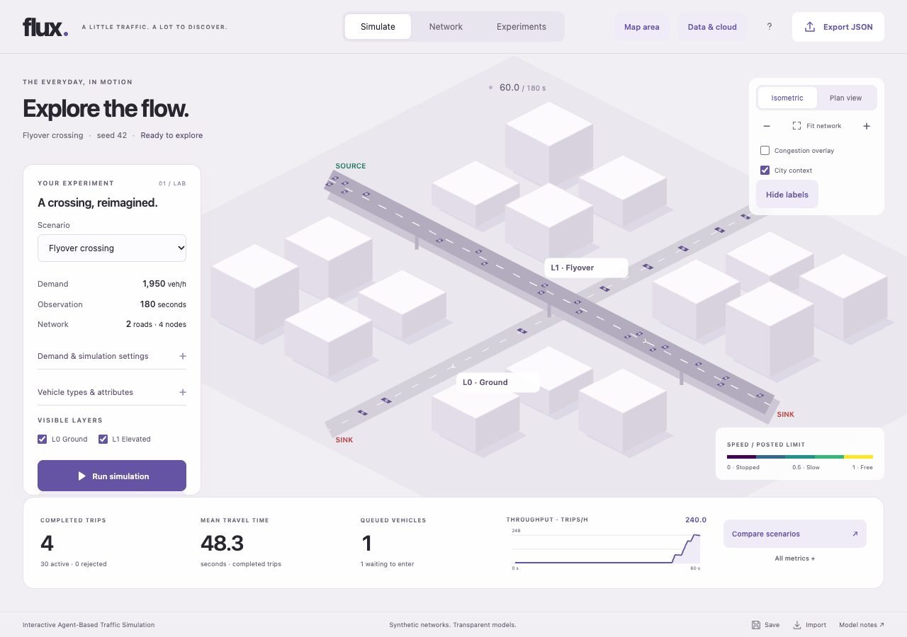

# Flux

Interactive Agent-Based Traffic Simulation. Build a network, simulate vehicle journeys and compare infrastructure changes using a shared deterministic engine.



Flux is a **full-stack React/TypeScript application**: a Canvas browser interface, interactive Web Worker simulation, Node.js API, PostgreSQL persistence and isolated server simulation jobs. The owner selected Layered City (C) before UI implementation and expanded the original browser-only scope on 6 November 2026.

## Run

Requires Node 24.12+ and npm. Python 3 is used for the isolated browser-worker tests.

```sh
npm ci
npm run dev
```

Visit http://127.0.0.1:5173. Vite proxies /api to the Node backend on 3001. Local PostgreSQL-compatible data persists in ignored `.flux-data/postgres` through PGlite. For a built same-origin app, run `npm run build` followed by `npm start` and visit http://127.0.0.1:3001. Stop another server using the same local database directory first. Backend edits require restarting dev.

## Use

- **Simulate:** four presets, seed/demand/horizon settings, run/pause/step/advance/reset, playback speed, isometric/plan camera, layers, congestion and label visibility, real metrics and detailed charts.
- **Map area:** choose Bengaluru, Mumbai, Chennai, Pune, Hyderabad or Delhi; pan/zoom and draw a 50–800 m rectangle, preview major OSM roads, compact curved geometry, grouped roundabouts and automatic directed boundary sources/sinks, then load the section into the simulation. No account or API key is needed. Starter traffic is explicitly synthetic and editable; see [map selection](docs/map-selection.md).
- **Network:** create/drag/delete nodes and roads, configure lanes/dimensions/speeds/priorities/signals/layers, explicit ramps, source/sink roles and OD demand, with undo.
- **Experiments:** at-grade/flyover or one-/two-lane bottleneck pairs, or capture/edit a baseline. Both runs receive identical scheduled demand and seed, with aligned charts and report export.
- **Data & cloud:** local account signup/login, owner-scoped server scenario library, retained OSM/observed-count imports with source/license/time/hash, server jobs/progress/cancellation/history and report downloads. Jobs continue after closing the browser. Production registration defaults off.
- **Device saves and JSON:** browser-local saves and portable versioned scenario import/export remain available. Server reports/saves retain import provenance; plain scenario JSON/device saves do not.

A real, attributed small Bengaluru road sample is included; it contains **no assumed observed traffic counts**. The observed-demand importer requires mapped OD vehicle counts and converts the observation exposure to constant mean rates. [Minimum data request](docs/data-request.md) and [six-city source review](docs/real-data-sources.md) explain what is still missing for calibration. [Vehicle types & attributes](docs/vehicle-types.md) supports six configurable classes or a percentage mix, including dimensions and driving parameters. This remains a simplified lane-based model without calibrated Indian mixed-traffic behaviour.

## Secrets and TomTom

**All real application/deployment secrets belong in Azure Key Vault.** Never put them in chat, code, committed configuration or shell arguments. Azure uses managed-identity Key Vault references. Local development can use non-secret `FLUX_KEY_VAULT_URL`, `FLUX_ENABLE_TOMTOM=true` and an authorized Azure CLI identity after the joint Azure review; the SDK retrieves the key directly from the vault. Local plaintext provider/database credential injection is rejected. No real credentials are needed for normal local simulation/persistence.

TomTom integration is optional, authenticated, bounded and server-side. It provides transient attributed nearest-segment speed/travel-time estimates for the six requested city regions. No live call/coverage is claimed until vault access and entitlement are verified. Commercial observations are excluded from database/report retention. They are not automatically converted to OD counts or legal speed limits.

## Verify

```sh
npm run check
npm run build
PLAYWRIGHT_BROWSERS_PATH=.tools/ms-playwright npx playwright install chromium
npm run test:e2e
npm run test:browser-worker
npm run test:load
npm run secrets:check
```

The required gate covers positive/negative/edge unit cases, integration, real browser flows, scientific invariants, local penetration/security checks, rendered 500+ vehicle performance and 120 authenticated API users. No code is committed before those checks run. The final 120-user run follows full backend/UI integration. See [testing](docs/testing.md), [security](docs/security.md), [backend/API contract](docs/backend.md) and [feature audit](docs/feature-audit.md).

## Azure and project records

Terraform defines billable Container Apps, private PostgreSQL, Key Vault, managed identities, ACR and an administrative migration job. Backend provisioning is disabled by default and staged so the owner enters credentials directly into Key Vault before database creation. State remains private because PostgreSQL provisioning still includes sensitive values. **No Azure deployment has occurred**; login, costs, plan/apply, live Key Vault access, container build and public HTTPS checks await the agreed joint review. [Deployment instructions](docs/deployment.md).

Architecture, scientific methodology, validation and limitations are in docs/. The revised [master prompt](docs/master-prompt.md) reflects the owner's new requirements; [the original](docs/master-prompt-original.md) remains byte-identical to the attachment. The raw continuous session log remains unedited outside Git. Session-eligibility limitations and the timebox remain recorded candidly in [progress](docs/progress.md).
