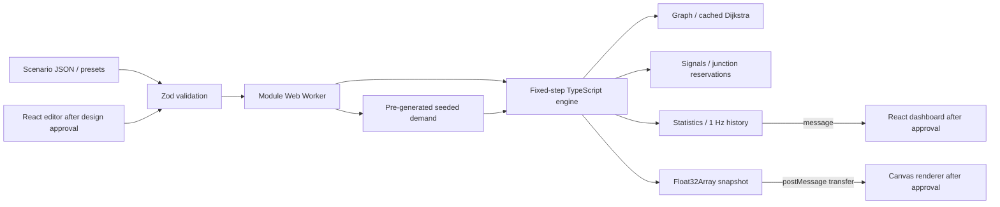

# Flux architecture

`src/model` owns schemas and import/export bounds. `src/scenarios` constructs validated synthetic networks. `src/engine` separates PRNG, demand, graph/geometry, vehicle law, signal control, statistics, scheduler and experiments. `src/worker/protocol.ts` defines a typed command/response boundary; `runtime.ts` injects transport for tests; `simulation.worker.ts` binds it to browser globals.

The worker schedules fixed numerical steps at 30 Hz wall-clock intervals. Playback multipliers process 1/2/4/8 numerical steps per interval; under load wall-clock playback slows rather than changing physical dt. Render interpolation will use requestAnimationFrame independently and will never feed positions back to the engine. No SharedArrayBuffer is used.

Snapshots contain nine Float32 fields per agent: ID, edge index, lane, position, speed, x, y, heading, elevation. Each message transfers the snapshot's ArrayBuffer; the engine's authoritative vehicle objects remain intact. Metrics and history are structured-cloned. `ping/pong`, load/play/pause/step and chunked paired comparison are implemented. Comparison yields between 150-step chunks; loading a new scenario cancels an old comparison by generation ID. Errors become typed error responses.

UI, persistent scenario editing and browser rendering are pending the owner design gate. Azure hosting is static; there is no backend or user-account system.
