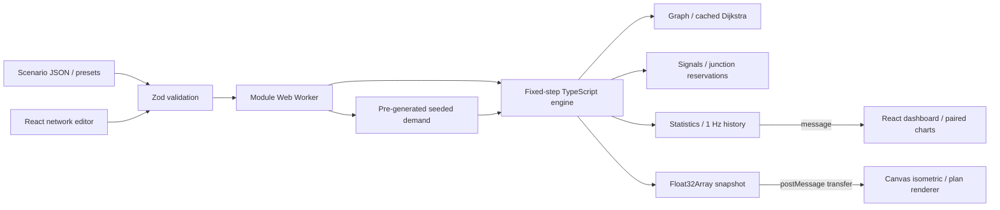
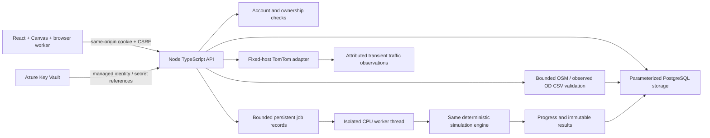

# Flux architecture

`src/model` owns schemas and import/export bounds. `src/scenarios` constructs validated synthetic networks. `src/engine` separates PRNG, demand, graph/geometry, vehicle law, signal control, statistics, scheduler and experiments. `src/worker/protocol.ts` defines a typed command/response boundary; `runtime.ts` injects transport for tests; `simulation.worker.ts` binds it to browser globals.

The worker schedules fixed numerical steps at 30 Hz wall-clock intervals. Playback multipliers process 1/2/4/8 numerical steps per interval; under load wall-clock playback slows rather than changing physical dt. Render interpolation will use requestAnimationFrame independently and will never feed positions back to the engine. No SharedArrayBuffer is used.

Snapshots contain thirteen Float32 fields per agent: ID, edge index, lane, front position, speed, x, y, heading, elevation, physical length, width, type index and body-shape index. Producer/renderer share SNAPSHOT_STRIDE. Optional fleet profiles and separately seeded type assignments are shared by browser/server engines. Metrics include per-type accounting; history stays aggregate. See vehicle-types.md. Each message transfers the snapshot's ArrayBuffer; the engine's authoritative vehicle objects remain intact. Metrics and history are structured-cloned. `ping/pong`, load/play/pause/step and chunked paired comparison are implemented. Comparison yields between 150-step chunks; loading a new scenario cancels an old comparison by generation ID. Errors become typed error responses.

`src/ui` owns camera projection/inversion, interactive Canvas rendering, validated editor operations, a bounded localStorage library, SVG charts and the React workspace. The owner approved C before these files were created. Isometric geometry is a drawing transform of the same graph; source/sink roles, ramps and topology are edited through native forms as well as gestures. Scene changes reload the worker and invalidate cached routes. Comparison charts share numeric scales and time horizons.

The original static architecture was superseded by the owner-authorized full-stack revision on 6 November. The following server boundary now complements browser simulation. `scripts/serve-dist.mjs` is a loopback-only production QA server that applies staticwebapp.config.json headers for browser tests. It is not a deployed server component. The real app has been tested with 500+ moving agents while collecting worker metrics and rendering; see the browser benchmark and testing record. Live Azure verification is deferred.

## Full-stack server boundary

server/database.ts provides the shared PostgreSQL schema/migration and local PGlite/production pg adapters. server/app.ts owns HTTP boundaries, sessions/CSRF and owner-scoped persistence. server/jobs.ts bounds admission, progress, timeouts, cancellation and restart handling; simulation-job.ts runs the same engine independently of the event loop. One API replica/CPU worker is supported. The queue is not a distributed scheduler.

server/imports.ts retains source data and normalization warnings. server/secrets.ts retrieves local integration credentials from Key Vault using authorized developer identity; Azure resolves managed-identity references. The migration job has a separate identity and administrator connection reference; the HTTP service receives only its restricted runtime connection and optional provider key. Browser code never contacts TomTom or receives credentials. OSM raster tiles are public direct browser image requests; map geometry comes through the bounded backend. Authentication password/session hashes remain in the application database.

The production Node service serves frontend assets and API on one origin, preserving strict CSP and cookie/CSRF rules. scripts/qa-server.mjs launches that actual compiled service with an isolated persistent test database for browser tests. scripts/serve-dist.mjs remains only an explicitly named legacy static preview utility. Azure plan/apply, container image and live vault/network checks remain pending joint review.

## Road shape and grouped structures

Edges may carry bounded interior `shape` points. Network sampling, vehicle snapshots, Canvas paths/vehicle placement, hit testing and signal approach orientation use that geometry. Map imports clip directed roads, preserve short entry pieces, compact geometry-only vertices and validate the final 300-node/1,000-edge graph. Raw map geometry has separate byte/reference limits. True junctions/controls, boundaries, layers and attribute changes are preserved.

Optional scenario `roundabouts` entities reference one complete directed cycle of ports/arcs. Schemas check ownership of members, references, layers, uniqueness and connected cycle structure. The editor offers one group selection with lane/speed updates, delete and undo, hiding internal members from the ordinary lists; the shared graph still routes circulating traffic over the retained arcs. The server stores the same validated JSON, so no SQL migration is needed for these optional fields. Legacy version-1 files remain readable; older Flux releases may reject files containing the new optional fields.

### Vehicle presentation and default mix

New presets/OSM imports use the explicitly assumed 30/50/12/4/2/2 car/two-wheeler/auto/LCV/bus/truck mix from src/data/traffic-mix.json. Saved/legacy scenarios preserve their existing fleet. The six original vehicle meshes use normalized footprint coordinates plus visual height, rotate with road direction, apply directional lighting, back-face culling and depth ordering, and draw projected polygons through the existing canvas. The SVG settings preview uses the same mesh/projector. Small sprites retain 3D volume while skipping wheel/trim detail; offscreen sprites are culled. Body appearance and visual height never feed into the simulation engine or profile validation.

### GHCR deployment revision

The owner-selected registry is GHCR, with immutable Flux image digests. No Azure registry is provisioned. A manual GitHub workflow gates Buildah/Podman build/smoke/publication on the app tests. Private Azure pulls resolve a read-only GHCR token from Key Vault using secret-scoped runtime/migration identities; managed identity does not directly authenticate to GHCR. The owner executes Terraform from macOS with Azure CLI/Entra-backed Blob state. See deploy-mac-ghcr.md for the current stages and unverified cloud boundaries.
