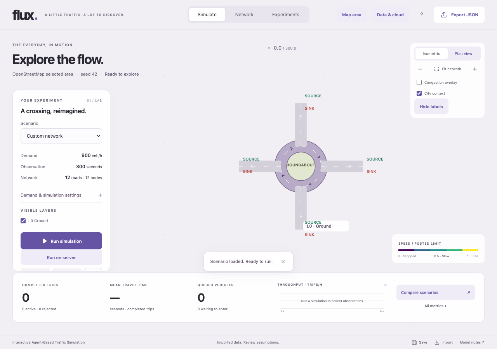
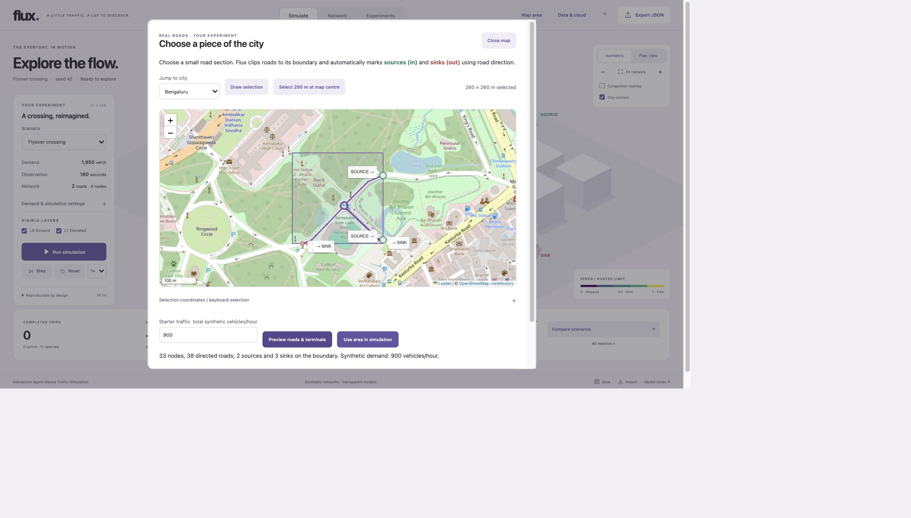

# Select an OpenStreetMap road section

Map imports now include **major motor roads only**: motorway, trunk, primary, secondary and tertiary roads and their links. Local streets, alleys, service roads, cycleways and walkways are excluded. Tagged roundabout arcs connected to major roads are retained even if their own road class is inconsistent. Existing file/sample imports retain their broader public-motor-road profile.

Open **Map area** in the header. No account or API key is needed for the map and browser simulation; server saves/jobs still require sign-in.

1. Choose Bengaluru, Mumbai, Chennai, Pune, Hyderabad or Delhi. The Bengaluru map opens on Kasturba Road, rather than the previous local/service roads inside Cubbon Park. These shortcuts move the map; they are not preloaded city traffic datasets.
2. Pan/zoom to a junction or corridor. Choose **Draw selection**, then press and drag (mouse or touch) to size the rectangle with a live preview. Two opposite-corner clicks also work. Panning/gesture zoom are paused while drawing and restored after finishing or cancelling; Escape cancels drawing before closing the workspace. Alternatively select a 260 m square at the map centre, or enter south/west/north/east under keyboard selection.
3. Keep each side between 50 and 800 m. Set total starter synthetic vehicles/hour (default 900; zero is allowed).
4. Choose **Preview roads & terminals**. Purple roads show the clipped network; green **SOURCE** markers admit traffic, red **SINK** markers remove it. Inspect the assumptions/provenance.
5. Choose **Use area in simulation**, then Run or advance time. Network exposes the generated terminal IDs, OD rates, lanes, speeds and controls for editing. To execute on the backend instead, choose **Use area on server** directly from the preview, or **Run on server** beside browser playback. Sign in, review the network/demand/duration summary, then choose **Run current on server**. Opening this view does not submit a job. The job retains its scenario and provenance without a separate save/export step. It starts at time zero; live browser vehicle positions are not transferred. Results/progress/history are available in Data & cloud. The backend currently runs locally; Azure deployment remains deferred.

## How terminals are assigned

The backend reads public drivable OSM ways with their dependent nodes and expands each way into directed segments. Explicit `oneway=yes/1/true`, reverse `-1`, implicit motorway/roundabout direction and bidirectional roads use the existing importer rules. Roads stay on their mapped elevation layers; coincident geometry never adds a cross-layer junction.

The selected geographic rectangle is projected into a local metre plane. Liang–Barsky clips each directed segment to that rectangle. Its start on the boundary is an entry/source; its end on the boundary is an exit/sink. Two-way roads have separate entry and exit terminal IDs at the same geographic crossing. Those terminals do not connect to each other, so traffic cannot leave the area and return via an artificial outside link. A way that leaves and re-enters becomes separate inside routes. Exact boundary endpoints are terminals; tangencies and boundary-only segments are excluded. Internal dead ends retain junction roles.

Only connected same-layer sub-metre shape points within a one-metre cluster are collapsed before clipping. Short boundary pieces survive until compaction so they cannot accidentally erase an entry or exit. If a real connection is within one metre of the boundary, the error asks you to move that edge a few metres. Remaining roads use the engine's 10 m minimum operational length. This is a simplified road-network conversion, not survey-grade geometry. Geometry-only vertices become curved road shape points, preserving drawn bends and geometric path length without adding junction stops. True connections, signals, terminals, layers and attribute changes remain nodes. **Hide labels / Show labels** in the simulation toggles road/layer/node/source/sink/roundabout annotations without resetting time or traffic; signal state indicators remain visible. **Hide map labels** toggles Flux terminal tooltips in the map preview; street/place names are part of the OSM raster tiles.

Starter demand is **synthetic**. Reachability is checked using directed connectivity. Each eligible entry gets one furthest reachable boundary exit, measured by straight-line separation; the total requested rate is divided evenly across these pairs. Entries with no reachable exit receive no demand. No trips are sent through disconnected geometry. This is a convenient test workload, not an inferred OD matrix. Edit it or replace it with mapped observed OD counts for analysis. Selection with no usable entry-to-exit route fails explicitly.

## Data and service limits

The browser uses locally bundled [Leaflet 1.9.4](https://leafletjs.com/reference-1.9.4.html) and direct standard OSM tiles, with visible attribution, browser caching and a valid referrer. Tiles load only for the current view, without bulk downloads or offline prefetch. Public tiles are best-effort; sustained production usage needs an appropriately provisioned provider under the [OSM tile policy](https://operations.osmfoundation.org/policies/tiles/).

The backend calls only `https://api.openstreetmap.org/api/0.6/map.json`, adding a 100 m buffer before clipping. It identifies Flux, rejects redirects, accepts JSON only, times out after 12 s, and caps the map response at 8 MB (uploaded OSM files remain capped at 2 MB). Selection is 50–800 m per side; raw map parsing is capped at 20,000 elements and 20,000 referenced segments, separately from the resulting simulation at 300 junctions/terminals, 1,000 directed roads and 100 OD pairs after clipping and compaction. Road shape is bounded at 500 points/edge and 20,000 points/scenario. Smaller selections may be needed in dense areas. Six map requests/IP/minute, thirty/server/minute (including cache hits), two concurrent upstream calls, and four cached raw extracts with five-minute freshness bound public-service and conversion load. These local controls are not a multi-replica quota service.

The [OSM map API](https://wiki.openstreetmap.org/wiki/API_v0.6#Retrieving_map_data_by_bounding_box:_GET_/api/0.6/map) selects ways with at least one node in the requested box. A very sparse way crossing the entire buffered box with no node inside can be absent. Inspect coverage; importing a complete OSM JSON extract remains available in Data & cloud. A map selection does not automatically create a retained raw-file dataset: raw extracts stay in the bounded process cache; the normalized scenario, source URL, retrieval time, license, hash and warnings can follow server saves/reports. Existing authenticated file imports retain their exact raw file separately.

OSM geometry does **not** supply observed traffic demand, actual signal phases/timings or empirical calibration. Missing lanes/speeds use disclosed defaults. Mapped signals remain priority-controlled until configured. Turn restrictions, conditional access, complex junction geometry and mixed Indian vehicle classes need model/data work before accuracy claims. Unsupported data, unavailable services and oversized/disconnected selections produce recoverable errors.

The 800 m side cap is a conservative product bound, not a benchmarked maximum or a claim that the simulation engine cannot handle larger geography. Removing only that cap would leave byte, raw-element, final-graph, OD, trip/population and worker limits in place. Increasing both dimensions from 800 m to 1.6 km quadruples the area; road density and traffic determine the actual workload. Larger areas can reduce artificial boundary effects and cover more junctions, but increase download/conversion, route-search, rendering, memory and run time. Longer journeys also need an adequate observation/warm-up horizon and matched demand. More geography alone does not establish accuracy. A future larger server mode needs representative size/density/traffic benchmarks, bounded admission and asynchronous import before raising these limits. No larger-area performance claim or limit removal is included in this release.

## Roundabout structures

A complete OSM `junction=roundabout` directed ring becomes one `roundabouts` entity, with references to only its necessary connection ports and circulating arcs. Bends remain in each arc's `shape`; dozens of map shape points no longer become nodes. The editor lists a single roundabout and hides its member ports/arcs from the ordinary inspector lists. Selecting it highlights the whole structure and permits group-wide lane/speed edits, deletion and undo. JSON imports/exports, server saves and simulation jobs retain the entity and curved geometry.

The canvas fills the actual mapped ring polygon as an island, with contrasting pavement/kerbs and direction arrows. It caps exaggerated display widths and vehicle glyphs relative to the island clearance, suppresses overlapping road badges and skips decorative buildings inside rings. Oval/irregular shapes stay mapped shapes. These are presentation changes; operational lengths, lanes, routing and vehicle physics are unchanged. The island is also selectable as the roundabout group. The screenshot below uses explicitly synthetic geometry, not an observed city roundabout.

The engine still needs ports and arcs to represent route length, circulating queues and entry/exit choices. Collapsing a whole roundabout to one point would lose those. Circulating approaches receive priority and entering vehicles yield while a circulating vehicle is within the simplified acceptance window (max of 8 m or three seconds of its current speed). This is an explicit engineering approximation, not observed gap calibration; multilane weaving, detailed conflicts and mixed vehicles remain simplified. Split OSM ways are grouped when their selected arcs form one complete directed cycle. Partial rings, untagged circular streets and `junction=circular` are not assumed to be priority roundabouts.

The same composite approach would benefit signalized intersections (approaches, movements and measured phases), motorway interchanges/flyover complexes (ramps and explicit layers), merge/diverge junctions (lane allocation and right-of-way), and toll plazas (booths and queues). These are suggestions for later model extensions, not implemented entity types.

## Why the frequent error changed

The old importer validated all downloaded elements, counted raw shape vertices as junctions and hid conversion exceptions behind the same 300/1,000-limit message. It also could omit a sub-metre clipped entry before simplification. The new path filters major roads and outside geometry first, compacts shapes before applying the unchanged actual graph limits, bounds raw download work separately, retains short entry pieces, and reports empty major-road areas, missing boundary routes, actual simplified counts, validation/provider failures and near-boundary connections distinctly. A truly empty/disconnected or overly complex selection still needs adjustment.

## Verification

Automated cases cover forward/reverse/two-way crossings, exact borders/corners/tangencies, disconnected entries, internal dead ends, re-entry, grade separation, sub-metre geometry, zero demand, deterministic conservation, invalid/injected/oversized requests, fixed-host transport, cache/quotas/concurrency, HTTP save/job integration and browser workflows. Browser tiles/geometry in automated tests are labelled synthetic fixtures; they do not call public services. The original live check and its historical screenshot remain in testing.md. The revised major-road importer and grouped roundabout/label controls were checked again after this change. Synthetic roundabout fixtures are explicitly labelled; they are not observations of actual city traffic. This verifies integration, not traffic calibration. Full gate and repeat 120-user results are in testing.md.

Drawing containment regression: React keeps the map container class static so toggling drawing cannot erase Leaflet layout classes. Map paint is explicitly contained. Browser regressions cover desktop/tablet/phone boundaries, mouse/touch drag without panning, restored normal panning, two-corner clicks and Escape cancellation. A native live press-drag check selected a 326 × 256 m rectangle and loaded its four terminals/two directed major roads successfully; screenshots/map-drag-selection.png records the result.
