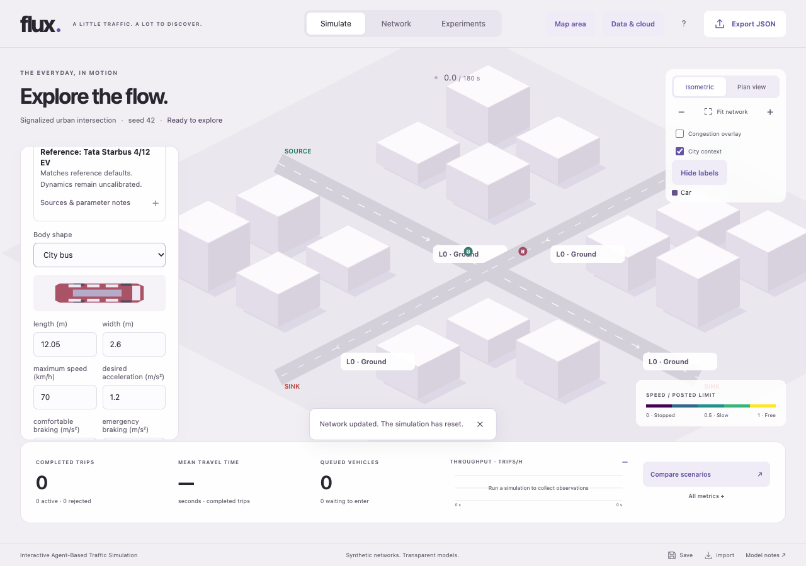

# Vehicle types, reference data and traffic mixes

Open **Simulate → Vehicle types & attributes**. Choose one type or **Mixed traffic**, set shares totalling 100%, edit a profile, then **Apply vehicle settings**. Applying starts again at time zero. **Sources & parameter notes** identifies the reference model, market, source links and acceleration category. The footprint preview and moving glyph use the selected schematic body shape. JSON exports, device/server saves, jobs and reports retain the profile. **All metrics → By vehicle type** shows class accounting and available speeds/travel times.

## Reference defaults, revision 2026-11-07-ref1

These are **named representative models, not universal class averages or a calibrated Indian fleet**. Manufacturer specifications supply nominal length, width and technical maximum speed. Export/historical variants are explicitly identified; technical capability is not a legal or governed Indian speed limit. Initial mix is an explicitly synthetic 100% car profile. Real road limits also cap the simulated speed.

| Type / reference | Length × width (m) | Technical maximum (km/h) | Desired acceleration (m/s²) | Acceleration basis |
|---|---|---:|---:|---|
| Car — Suzuki Swift 1.2 MHEV manual 2WD, UK | 3.860 × 1.735 | 165 | 2.600 | Generic passenger-car model parameter |
| Two-wheeler — TVS Raider model family | 2.080 × 0.767 | 99 | 2.825 | Derived mean from factory 0–60 km/h in 5.9 s |
| Auto-rickshaw — Bajaj RE250, global export | 2.635 × 1.300 | 65 | 0.600 | Research-informed engineering assumption |
| Light commercial — Tata Ace Gold Diesel BS6 Phase 2, India | 3.800 × 1.500 | 65 | 1.300 | Generic truck model proxy |
| Bus — Tata Starbus 4/12 EV, India | 12.050 × 2.600 | 70 | 1.200 | Generic city-bus model parameter |
| Rigid truck — Tata LPT1618, 4,800 mm wheelbase, historical Euro II/LHD export | 8.665 × 2.440 | 105 | 1.300 | Generic rigid-truck model parameter |

The [Suzuki brochure](https://cdn.suzuki.co.uk/suzuki-gb/svzlmg5n/suzuki-swift-ebrochure-uk.pdf) PDF page 18 distinguishes the manual 165 km/h, CVT 170 and ALLGRIP 160 variants; Flux uses the manual 2WD column. Raider dimensions come from [TVS Chile](https://www.tvsmotor.com/en/cl/our-products/tvs-raider-fi), while speed/acceleration-test results come from the [Indian manufacturer release](https://www.tvsmotor.com/media/press-release/tvs-motor-raises-the-bar-with-new-tvs-raider-wicked-update-tvs-raider-smartxonnecttm-with-tft-cluster). This is a disclosed model-family proxy across markets, not one certified variant. The [Bajaj RE250 specification](https://cdn.globalbajaj.com/en/Brands/RE/RE250), [Ace brochure](https://smalltrucks.tatamotors.com/assets/smalltrucks/files/2025-01/ACE%20GOLD%20DIESEL.pdf) page 2, [Starbus brochure](https://busesandvans.tatamotors.com/assets/buses/files/2024-11/616-24-Tata%20Motors-EV-Bus-Starbus-4-12.pdf) page 2 and [LPT1618 export brochure](https://countrysites-tatamotors-com.s3-ap-southeast-1.amazonaws.com/countrysite/wp-content/uploads/sites/13/2016/06/03072525/LPT-1618_LHD.pdf) pages 3–4 supply the remaining dimensional/speed facts. Truck length is overall length, not load-deck length; bus width excludes mirrors. Nominal footprints do not include turning swept paths.

Acceleration is the existing IDM model's free-road/desired acceleration parameter, not a guarantee of measured acceleration at every speed, load or grade. Generic car/truck/bus values are initial proxies from [SUMO's parameter references](https://sumo.dlr.de/docs/Vehicle_Type_Parameter_Defaults.html); these depend on the following model and require fitting when transferred to Flux's IDM. Flux still uses its own engine. Raider's `(60/3.6)/5.9` is a derived mean, not peak acceleration or a fitted curve. The auto's 0.6 is an engineering starting assumption informed by [Ramireddy et al. (2021)](https://pp.bme.hu/tr/article/download/16796/9272), Table 1: three-wheeler approach means 0.350–0.552 m/s². The overall observed mean 0.427 must not be mistaken for the IDM parameter or a RE250-specific measurement.

Comfortable braking remains 2 m/s² for all types. Emergency braking is 8 for car/two-wheeler and 7 for the other types. Minimum gaps are 2 / 1 / 1.5 / 2 / 2.5 / 2.5 m; headways are 1.5 / 1 / 1.2 / 1.4 / 1.8 / 1.7 s in table order. These are **uncalibrated model settings**, with [IDM documentation](https://mtreiber.de/MicroApplet/IDM.html) providing parameter context rather than evidence that these exact classes were measured. Shape polygons are original schematic illustrations, not OEM CAD.

The machine-readable catalogue is [vehicle-references.json](../src/data/vehicle-references.json). It records source URL, retrieval timestamp, units, SHA-256, reuse-status notes, model/market and derivation. Raw source documents remain in ignored `.tools/research/vehicle-sources`; proprietary brochures/media are not redistributed. All factual defaults and source hashes were checked against retrieved bytes; PDF specification pages were rendered and visually inspected.

## Engine behaviour

Profiles parameterize acceleration, comfortable braking, emergency clamp, following gap and headway. Explicit profiles use the lower of road/type speed limits; driver variation may reduce it. Hard finite-step gap projection remains an additional numerical safeguard and can impose more abrupt corrections than nominal braking. This is not physical collision-safety certification.

Body length determines storage and occupancy. Lane changes use the moving vehicle's front-gap/headway requirement and the follower's rear requirement. Junction readiness uses the vehicle's own gap; reservations depend on length/speed. Delay uses that vehicle's free-flow speed cap.

Vehicle-aware Dijkstra excludes lanes narrower than the body and segments shorter than `length + minGap`, with a 1e-9 m floating-point tolerance at fit boundaries. It uses a fitting alternative or accounts for a rejected trip. Whole-body storage is required within one edge: a short mapped segment can exclude buses/trucks even where a real vehicle could straddle the junction. Review short segments rather than shrinking real dimensions. Width is a fit check, not a sublane or swept-turn collision model.

Snapshots carry physical length, width, type and body-shape indices. Glyphs rotate along roads; dimensions follow operational-to-drawn path scale, with lane-width/roundabout display caps for legibility. Colours have a text legend. Preview silhouettes stay inside the nominal footprint. Display adjustments do not change numerical dimensions.

## Compatibility and comparison

New UI presets and OSM imports use the reference fleet. Existing version-1 JSON, device and server saves retain their values. Old explicit profiles without provenance remain custom/earlier values until **Reset selected type defaults** is chosen and applied. A reference revision identifies the starting catalogue; the UI checks actual attributes before saying they match. Custom edits remain editable and travel with the scenario.

Optional `fleet` accepts one to six unique known IDs, eight numeric attributes and shares totalling 100%, with optional validated body-shape and reference-revision fields. Unknown fields/types, non-finite values, invalid bounds and emergency braking below comfortable braking are rejected by worker/API validation. Files without `fleet` retain the original variable 4.2–5.4 m car model and original following/speed variation. Applying settings opts into explicit profiles. Older releases may reject the new optional fields.

The global mix applies to all OD pairs and uses a separate seeded sampling stream: short runs need not match exact shares. Mix edits do not change arrival times. Paired experiments copy baseline demand, seed, duration and full vehicle profiles/assignments to both networks. Configure then **Capture current as baseline** before geometry edits. Reports use `null` for unavailable means; older results without class breakdown remain readable.

## Remaining accuracy work

Two-wheelers follow lanes without filtering or side-by-side movement. Buses have no stops, dwell times or schedules. Truck swept turns, articulation, load/power/gradient response, emissions, class-specific legal/governor controls and empirical lane-changing behaviour remain unimplemented. Actual asymmetric signal stages remain separate work.

The OD importer accepts unclassified vehicle trips and preserves the configured fleet without inferring shares. Classified movement counts and independent class-specific speed, headway, queue and travel-time observations are still needed for fitting. The new references improve explicit starting assumptions; they do not establish Bengaluru accuracy.

