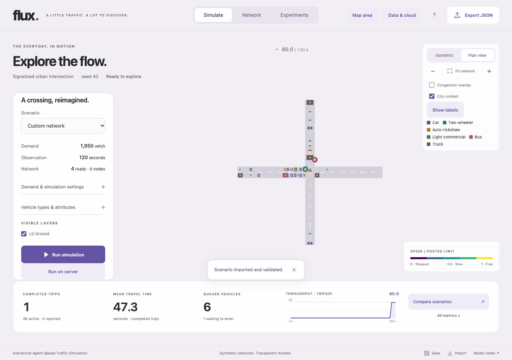

# Vehicle types and traffic mixes

Open **Simulate → Vehicle types & attributes**. Choose a single type or **Mixed traffic**, set shares totalling 100%, select a type to edit, then **Apply vehicle settings**. Applying resets time to zero. Profiles travel with JSON exports, device/server saves and server jobs. The server review shows the applied mix. **All metrics → By vehicle type** shows generated, active, completed and rejected trips plus available mean speeds/travel times; server reports retain the same breakdown.

The global mix applies to all OD pairs. Shares are probabilities sampled using a separate seeded stream; short runs need not achieve exact percentages. Editing the mix does not change arrival times. These defaults are **illustrative assumptions**, not observed fleet shares, manufacturer specifications or a calibrated Indian traffic model.

| Type | Length × width (m) | Maximum km/h | Acceleration m/s² | Comfortable / emergency braking m/s² | Minimum gap m | Headway s |
|---|---|---:|---:|---|---:|---:|
| Car | 4.8 × 1.8 | 120 | 1.5 | 2 / 8 | 2 | 1.2 |
| Two-wheeler | 2 × 0.8 | 80 | 2 | 2.5 / 8 | 1 | 0.8 |
| Auto-rickshaw | 2.8 × 1.4 | 50 | 1.2 | 2 / 7 | 1.5 | 1 |
| Light commercial | 6 × 2 | 90 | 1.2 | 2 / 7 | 2 | 1.4 |
| Bus | 12 × 2.5 | 80 | 0.8 | 1.5 / 6 | 2.5 | 1.8 |
| Truck | 10 × 2.5 | 80 | 0.7 | 1.5 / 6 | 2.5 | 2 |

## Engine behaviour

Profiles parameterize the existing IDM-based model. Acceleration, comfortable braking, emergency clamp, following gap and headway are vehicle-specific. With an explicit profile, speed is capped by both road/type limits; driver variation may reduce it. Hard finite-step gap projection remains an additional numerical safeguard and can impose more abrupt corrections than nominal braking. This is not a physical collision-safety certification.

Body length determines storage and occupancy. Lane changes use the moving vehicle's front-gap/headway requirement and the follower's rear requirement. Junction readiness uses the vehicle's own minimum gap; reservations depend on length/speed. Delay uses a free-flow reference with that vehicle's speed cap.

Vehicle-aware Dijkstra excludes lanes narrower than the body and segments shorter than `length + minGap`, using a 1e-9 m floating-point tolerance for fit boundaries and weighting eligible roads by travel time at the lower of road/type maximum speed. It uses a fitting alternative when available; otherwise rejects the trip and accounts for its type. The model requires whole-body storage within an edge and cannot carry a long body across several short edges. Thus a mapped 10 m segment can exclude buses/trucks even when a real vehicle could straddle the junction. Review short segments rather than shrinking real vehicle dimensions to obtain desired results. Width is a fit check, not a sublane or swept-turn collision model.

Canvas snapshots carry physical length, width and type index. Body length follows operational-to-drawn path scale, while lane widths and roundabout glyph caps preserve legibility. Colours identify types with a text legend. Display adjustments never feed back into engine dimensions.

Parameter categories follow established microsimulation terminology; see [SUMO's vehicle-type definitions](https://sumo.dlr.de/docs/Definition_of_Vehicles%2C_Vehicle_Types%2C_and_Routes.html#available_vtype_attributes). Flux uses its own engine; no external calibrated model or measured parameter set has been adopted.

## Compatibility and comparison

Optional scenario `fleet` contains one to six unique known IDs with eight attributes and shares totalling 100%. Unknown fields/types, non-finite values, invalid dimensions/limits and emergency braking below comfortable braking are rejected by worker/API validation. Existing version-1 files without `fleet` retain the original car model: variable 4.2–5.4 m length, 1.8 m width, original following parameters and desired road-speed variation. Applying vehicle settings opts into explicit profiles and hard road/type caps. Older Flux releases may reject the new optional field.

Paired experiments copy baseline demand, seed, duration **and full vehicle profiles/assignments** to both networks. Configure a network and **Capture current as baseline** before editing geometry to compare infrastructure with that mix. Shared conditions and the server review disclose the baseline mix. Reports use `null` for unavailable per-type averages; older saved results without a breakdown remain readable.

## Remaining accuracy work

Two-wheelers follow lanes without filtering or side-by-side movement. Buses have no dwell times, stops or schedules. Detailed truck turning radii, articulation, mass/power/gradient response, emissions, class-specific legal access and empirical lane-change/gap behaviour are not implemented. Actual asymmetric signal stages remain separate work.

The OD importer reads unclassified motor-vehicle trips. It preserves configured profiles and warns that class shares/behaviour were not inferred from those counts. Classified movement counts and independent class-specific speed, headway, queue and travel-time observations remain necessary for fitting and real-city accuracy claims. No survey data was fabricated or imported by this feature.

